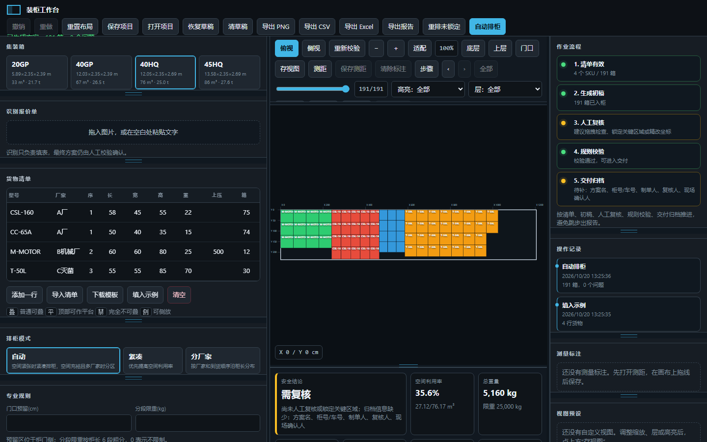

# 装柜工作台

外贸出货前的集装箱装柜规划工具：输入货物清单，算法生成装柜初稿，人工在画布上复核调整，后端按装柜规则校验，最后导出给仓库和现场使用的方案报告。在外贸公司实际业务中使用，打包为 Windows 单文件 exe。



## 项目亮点

- **排柜算法**：启发式三维排柜，枚举 6 种摆放方向（限直立货物只允许水平旋转），沿柜长推进并利用箱顶平台和末列空位回填；多厂家货物在紧凑排法利用率偏低时自动改为按厂家分区。可锁定已摆好的部分，只重排剩余货物。
- **规则校验**：越界、碰撞、门口预留区、底面支撑（按接触面积计算，防止悬空）、不可堆叠、单箱累计上压、柜长 6 段分段限重、重心偏载、漏放/多放。问题直接在画布上高亮并给出一键修复动作。
- **AI 识别清单**：报价单截图或文字交给通义千问视觉模型识别成货物清单，结果先做结构校验再进表格。
- **交付**：`.cpack` 项目文件、浏览器自动草稿、操作记录留痕；导出 PNG、CSV、7 个工作表的 Excel 和 HTML 方案报告；PyInstaller 打包单 exe，打包前跑严格自检。
- **测试**：unittest 覆盖算法、校验器和接口契约，Playwright 真实浏览器冒烟测试。

技术栈：Python / FastAPI / Pydantic / 原生 JavaScript + SVG / Matplotlib / 通义千问 Qwen-VL / Playwright / PyInstaller

开发方式：本人负责需求、算法方案和业务规则验收，使用 Codex 辅助编码。

## 功能清单

本项目已经从“自动出一张装柜图”的原型，升级为本地运行的装柜方案工作台：

- 算法先生成初稿。
- 可下载标准清单模板，并从 CSV 或 `.xlsx` 导入货物清单；支持常见中英文列名并跳过无效行。
- 人工可以在 2D 画布里查看、选择、精确改坐标、旋转、锁定和撤销。
- 画布支持缩放、适配视图、Alt 平移、标尺、坐标读数、边缘吸附参考线、测距和保存测量标注。
- 工作台左右栏、侧栏面板、中间工具条和底部统计栏都支持拖拽边缘调整尺寸，布局会在本机浏览器里记忆，也可一键重置。
- 支持按装柜顺序回放前 N 箱，方便现场复核装柜过程。
- 支持按 Z 高度层过滤显示，检查底层/上层堆叠更快。
- 作业流程面板会提示清单、初稿、人工复核、规则校验、交付归档的当前状态。
- 操作记录面板会记录自动排柜、人工调整、锁定、重排、校验、导出和保存/打开项目。
- 安全结论会直接标明「可交付 / 需复核 / 不可交付」，并列出主要原因；缺少版本、制单、复核或现场确认信息会保持需复核。
- 导出报告前如果仍有错误、待复核项或缺少关键归档信息，会要求人工确认。
- 系统实时校验越界、碰撞、悬空、超重和不可堆叠等问题。
- 有问题的箱体会在画布上直接高亮：错误红框、警告黄框。
- 拖动箱体时会即时提示碰撞/进入门口预留区风险。
- 可设置门口预留区，自动排柜避让，人工占用会被校验指出。
- 可设置分段限重，按柜长 6 段检查局部压重风险。
- 可为每个 SKU 设置上压限重，校验下层箱体承受的累计上方重量。
- 统计栏显示空间、重量、箱数、重心 X/Y、前/后半柜重量和左/右半柜重量。
- 统计栏和报告会显示沿柜长 6 段粗分重量，辅助判断局部压重。
- 可锁定人工摆好的区域，只重排剩余货物。
- 可填写方案名、方案版本、柜号/车号、制单人、复核人、现场确认人和备注，并随项目文件和报告一起保存。
- 可保存/打开 `.cpack` 项目文件，保留自定义视图预设，可导出 PNG、CSV 明细、Excel 工作簿和 HTML 报告。
- 会自动在本机浏览器保存草稿，误关页面或刷新后可用「恢复草稿」找回最近方案。

## 运行

建议使用 Python 3.11-3.13。不要用预览版或过新的 Python 版本打包，`matplotlib` 可能没有可用 wheel。

```powershell
cd container-loading-planner
py -3.13 -m pip install -r requirements.txt
py -3.13 app.py
```

开发验收如果要跑真实浏览器烟测，首次额外安装：

```powershell
py -3.13 -m pip install -r requirements-dev.txt
py -3.13 -m playwright install chromium
```

启动后访问控制台显示的本地地址，通常是：

```text
http://127.0.0.1:17283/
```

## 核心文件

```text
app.py          FastAPI 接口、启动逻辑、AI 识别接口
_frontend.py    装柜工作台前端
_packer.py      装柜算法
_validator.py   方案校验器
_visualizer.py  PNG 三视图渲染
tests/          回归测试
build.bat       Windows 单 exe 打包脚本
```

## AI 识别

图片/文字识别依赖 DashScope。现在不再硬编码 API Key，需要运行前配置环境变量：

```powershell
$env:DASHSCOPE_API_KEY="你的 key"
python app.py
```

未配置时，识别功能会禁用，但手工填表、自动排柜、人工调整和校验仍可使用。

## 打包

```powershell
.\build.bat
```

打包脚本会检查 Python 版本、安装依赖、运行严格自检，然后生成：

```text
dist\ContainerPack.exe
```

## 已完成的产品化能力

- 移除源码默认 API Key，避免 exe 分发泄露密钥。
- AI 提取结果进入表格前做结构校验。
- 输入增加 SKU 数量、箱数、尺寸、重量上限。
- `/api/pack` 返回 placements，前端可继续编辑。
- 新增 `/api/validate_plan` 和 `/api/render_plan`。
- 新增 `/api/repack_unlocked`，支持锁定部分货物后重排剩余箱体。
- 新增独立校验器，覆盖碰撞、越界、悬空、超重、不可堆叠。
- 校验器会提示清单外 SKU、多放、漏放。
- 校验器会提示门口预留区占用，并在有效载重明显偏向一端时提示重心风险。
- 画布会把可定位的校验问题映射回具体箱体，方便现场直接处理。
- 拖拽过程中提供前端即时风险提示，松手后仍由后端规则校验给出正式结果。
- 修复“铺平可叠”平台把空位当支撑面的物理错误。
- 前端改为工作台布局：清单、画布、属性面板、校验面板。
- 工作台左右栏宽度、侧栏各面板高度、中间工具条高度和底部统计栏高度可拖拽调整，并支持恢复默认布局。
- 画布支持放大、缩小、适配整柜、Alt+拖拽平移、标尺和鼠标坐标读数。
- 拖动货物时默认按 5cm 网格移动，靠近柜壁、地面或其他箱体边缘时会自动吸附并显示参考线。
- 支持测距模式，在画布上拖线测量两点距离和 X/Y 或 X/Z 分量，并可保存为带名称和备注的正式测量标注。
- 支持步骤回放：按装柜顺序显示前 N 箱，可上一箱/下一箱/拖动滑块/恢复全部。
- 支持按 Z 层查看，只显示某一高度层的货物。
- 支持设置门口预留 cm，画布以红色虚线区显示柜门侧预留空间。
- 支持设置分段限重 kg，超过任一 1/6 柜长段会在校验结果中报错。
- 支持设置 SKU 单箱上压限重，超过承重能力会在校验结果中报错。
- 统计栏支持重心 X/Y、前半柜重量、后半柜重量、左半柜重量、右半柜重量。
- 支持按柜长 6 段估算分段重量，并显示最重分段。
- 支持安全结论摘要，综合错误、警告、未放箱、人工复核和归档信息判断交付状态。
- 支持 Ctrl/Shift 多选、框选、批量移动、批量旋转、批量锁定、方向键微调。
- 支持多选后对齐 X、对齐 Y、落地 Z。
- 支持按 SKU / 厂家高亮，非目标货物自动淡化。
- 支持方案信息：方案名、方案版本、柜号/车号、制单人、复核人、现场确认人、备注。
- 支持保存/打开 `.cpack` 项目。
  项目文件会保留方案信息、版本和确认人、图层状态、步骤回放状态、自定义视图预设、测量标注名称/备注和人工复核标记。
- 支持本机自动草稿：清单、方案、人工调整、测量标注、视图预设和操作记录会自动保存到浏览器本地，可用「恢复草稿」找回，「清草稿」只清除自动草稿，不会清空当前页面。
- 支持操作记录留痕，最近 200 条动作会随 `.cpack` 项目文件保存。
- 支持撤销/重做。
- 支持导出 CSV 装柜明细、Excel 工作簿和 HTML 方案报告。
  Excel 工作簿包含摘要、货物清单、装柜坐标、校验问题、分段重量、未放货物和操作记录。
  HTML 报告会内嵌当前装柜示意图和作业流程状态。

## 工作台操作

- 单击箱体：选择单箱。
- Ctrl/Shift + 单击：加选/取消选择。
- 空白处拖拽：框选多个箱体。
- 选中货物：画布会临时显示选中箱体或选区的尺寸标注；俯视显示 L/W，侧视显示 L/H。
- 「高亮」下拉框：按 SKU 或厂家定位货物。
- 「门口预留(cm)」：设置柜门侧预留空间，自动排柜会避开该区域。
- 「分段限重(kg)」：按柜长 6 段检查局部重量，0 表示不限制。
- 货物清单「上压」：该 SKU 单箱允许承受的上方累计重量，0 表示不限制。
- 「导入清单」：导入 CSV、TXT、TSV 或 `.xlsx` 货物清单。
  表头至少需要包含型号/SKU、长、宽、高、重量、箱数；常见列名如厂家、序、上压、规则、侧放也会自动识别。
  导入后会先进入预览面板，显示有效行、错误和警告；确认后才追加有效行。
- 「下载模板」：下载标准 `.xlsx` 清单模板。
  模板包含空白填表页、字段说明和填写示例；空白模板直接导入不会追加示例货物。
- 「方案信息」：填写方案名、方案版本、柜号/车号、制单人、复核人、现场确认人和备注；保存项目和导出报告时会带上这些信息。
- 「恢复草稿 / 清草稿」：恢复或清除浏览器本机自动保存的最近草稿；清草稿不会删除当前页面内容。
- 「作业流程」：按清单、初稿、人工复核、规则校验、交付归档提示当前方案状态。
- 「操作记录」：显示最近 8 条动作；保存项目会保留最近 200 条，导出报告会带最近 40 条。
- 「安全结论」：底部统计栏第一项会显示当前方案能否交付；有错误或未放箱为不可交付，有警告、未人工复核或缺少版本/确认信息为需复核。
- 右侧「规则校验」：点击问题可定位到对应箱体；对碰撞、越界、门口预留、悬空和上压问题，会提供「前移 5cm」「移出门口」「拉回柜内」「落地」等快速修复动作。
- 左右栏分隔条：按住清单栏/画布/右侧面板之间的竖线拖动，可调整工作区宽度。
- 面板底边：按住左侧或右侧面板底部细线拖动，可调整单个面板高度；「重置布局」会恢复默认尺寸。
- 中间横向分隔条：按住工具条/画布之间或画布/统计栏之间的细线拖动，可调整工具条和统计栏高度。
- 「+ / - / 适配」：缩放画布或回到整柜视图。
- 「底层 / 上层 / 门口」：快速切换常用视图预设，分别聚焦最低层、最高层或柜门侧区域。
- 「存视图」：保存当前视图方向、层过滤、高亮和缩放位置；右侧「视图预设」可改名、应用或删除。
- 「测距」：进入测距模式，在画布上拖一条线查看距离；再次点击或按 Esc 退出。
- 「保存测距 / 清除标注」：把当前测距线保存为画布标注，或清空已保存的测量标注。
- 右侧「测量标注」：编辑标注名和备注，点击「定位」回到对应视图，点击「删除」移除单条标注。
- 「步骤 / ‹ / › / 全部」：按装柜顺序回放当前方案。
- 步骤滑块：快速查看装到第 N 箱时的画布状态。
- 「层」下拉框：按 Z 高度层过滤当前画布；导出正式报告时仍输出完整方案。
- 「选本层 / 锁本层 / 解本层 / 重排本层」：对当前层可见货物批量选择、锁定、解锁，或只重排当前 Z 层；其他层会临时固定，便于逐层整理。若当前层上方还有货物，系统会要求确认并提示复核支撑关系。
- 鼠标滚轮：以鼠标所在位置为中心缩放。
- 拖拽货物：按 5cm 网格移动；靠近柜壁、地面或其他箱体边缘时自动吸附。
- Alt + 拖拽画布：平移视图，不移动货物。
- `M`：切换测距模式；Esc：退出测距模式。
- 左下角坐标读数：俯视显示 X/Y，侧视显示 X/Z。
- 拖动货物时左下角显示本次移动量：俯视为 ΔX/ΔY，侧视为 ΔX/ΔZ。
- 方向键：按 5cm 微调；Shift + 方向键：按 20cm 微调。
- `R`：旋转所选箱体。
- `L`：切换锁定。
- Delete/Backspace：删除所选箱体。
- 多选面板：「对齐 X」「对齐 Y」「落地 Z」用于快速整理一排货物。
- 多选面板：「等距 X」「等距 Y」「贴左」「贴右」「贴柜头」「贴门口」「贴中线」用于批量整理间距和贴边位置。
- 多选面板：「X 间距 / Y 间距」输入厘米值后点「按间距 X / 按间距 Y」，可按指定边到边间距重新分布所选货物；如果总宽度超过柜内尺寸会直接提示。
- 多选或单选后点「复制摆放」，再点「粘贴摆放」或按 `Ctrl+V`，可按原相对位置复制一组货物；系统只会粘贴清单里还有剩余箱数的 SKU，并自动生成新的箱号。
- 「重排未锁定」：保留锁定箱体，只重排未锁定的剩余货物。
- 「导出 CSV」：导出每箱坐标、尺寸、重量、锁定状态。
  CSV 会包含装柜顺序。
- 「导出 Excel」：导出可继续筛选、归档和交接的 `.xlsx` 工作簿。
  工作簿会分 sheet 保存摘要、货物清单、装柜坐标、校验问题、分段重量、未放货物和操作记录。
- 「导出报告」：导出可发给团队查看的 HTML 方案报告。
  报告会包含方案信息、方案版本、制单/复核/现场确认人、作业流程、装柜示意图、测量标注、阶段快照、装柜顺序、门口预留、分段限重、SKU 上压限重、重心 X/Y、前/后半柜重量、左/右半柜重量和分段重量。
  报告会在前部给出安全结论和复核要点。
  报告会附带最近的操作记录，便于交接时复盘人工调整和导出前校验。
  如果流程仍有错误或待复核项，系统会先弹窗确认。
  报告快照会自动去掉当前选中态和临时尺寸标注，只保留正式方案信息。

## 验证

```powershell
py -3.13 preflight.py
py -3.13 -m unittest discover -s tests
py -3.13 -m py_compile app.py _frontend.py _packer.py _validator.py _visualizer.py
py -3.13 text_quality.py
```

打包前建议使用严格渲染自检：

```powershell
py -3.13 preflight.py --strict-render
```

严格模式会要求 `matplotlib` 可用，确保 PNG 导出链路不会在 exe 中降级。
预检会自动运行 `text_quality.py`，检查源码、文档和测试文件是否残留常见乱码或非 UTF-8 文本。

真实页面烟测会临时启动本地服务，用 Chromium 打开页面，填入示例、自动排柜，并拖动工作台分隔条验证布局记忆：

```powershell
py -3.13 browser_smoke.py
py -3.13 preflight.py --strict-render --browser-smoke
```
